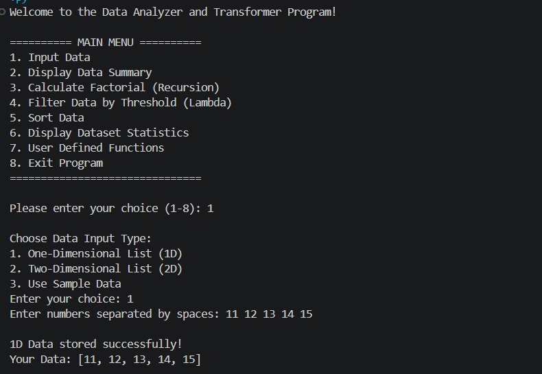
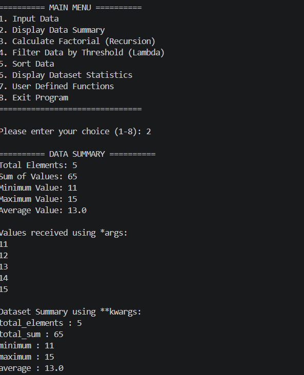
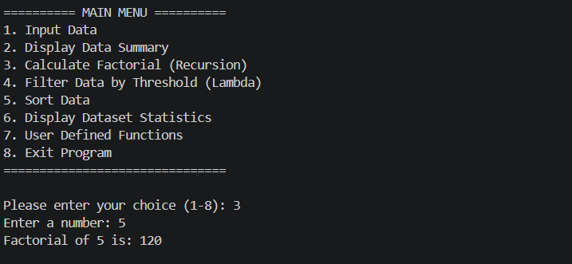
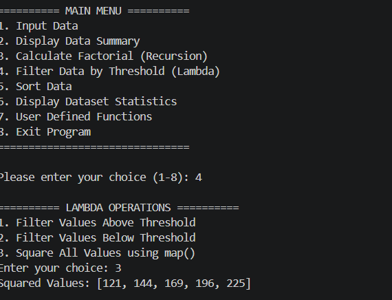
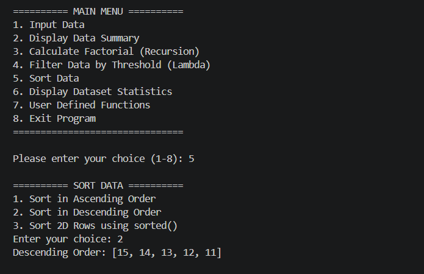
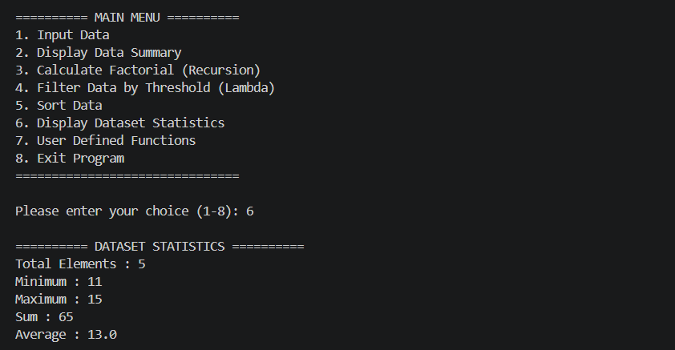
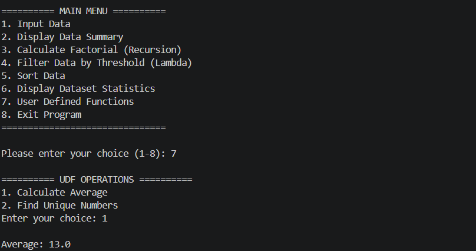

# Data Analyzer and Transformer Program

## Description
The Data Analyzer and Transformer Program is a menu-driven Python project designed to analyze and transform data using one-dimensional (1D) and two-dimensional (2D) lists.

This project demonstrates various Python concepts, including built-in functions, user-defined functions, recursion, lambda functions, `*args`, `**kwargs`, global variables, and list sorting.

## Features

- Input data using 1D and 2D lists.
- Use predefined sample data.
- Display basic data statistics.
- Calculate average using user-defined functions.
- Find unique values in a dataset.
- Demonstrate `*args` and `**kwargs`.
- Display function documentation using `__doc__`.
- Calculate factorial using recursion.
- Filter values using lambda functions.
- Transform list values using `map()` and `filter()`.
- Store dataset statistics using the global keyword.
- Return multiple values from a function.
- Sort 1D lists using `sort()`.
- Sort 2D lists using `sorted()`.

## Python Concepts Used

- Built-in Functions
- User-defined Functions (UDF)
- `*args` and `**kwargs`
- Docstrings (`__doc__`)
- Recursion
- Lambda Functions
- `map()` and `filter()`
- Global Keyword
- Returning Multiple Values
- 1D and 2D Lists
- `sort()` and `sorted()`
- Match-Case Statements

## Main Menu

The program provides the following options:

1. Input Data
2. Display Data Summary
3. Calculate Factorial (Recursion)
4. Filter Data by Threshold (Lambda)
5. Sort Data
6. Display Dataset Statistics
7. User Defined Functions
8. Exit Program

## Output Screenshots

The following screenshots demonstrate the working of the Data Analyzer and Transformer Program.

### 1. Input Data

### 2. Display Data Summary

### 3. Calculate Factorial

### 4. Lambda Operations

### 5. Sort Data

### 6. Dataset Statistics

### 7. User Defined Functions

