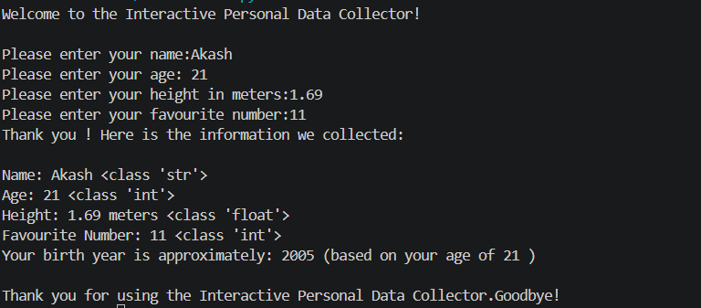

# Interactive Personal Data Collector

## About the Project
The Interactive Personal Data Collector is a beginner-friendly Python project that collects personal information from the user and displays it with its data type.

It also calculates the user's approximate birth year based on their age.

## Features
- Collects the user's name.
- Takes age as an integer.
- Takes height in meters as a float.
- Collects the user's favourite number.
- Displays the collected information with data types.
- Calculates the approximate birth year.

## Technologies Used
- Python
- `input()` function
- `print()` function
- Data types: `str`, `int`, and `float`
- Type conversion
- Basic arithmetic operations

## Learning Objectives
This project helped me practice:
- Taking user input.
- Converting input into different data types.
- Displaying data types using `type()`.
- Performing arithmetic calculations.
- Formatting output in Python.

## Output

